# Gaggia Bare Metal — журнал збірки

**Українська** | [English](build-log.md)

Gaggia Classic, перебудована з нуля: нова гідравліка, BLDC-помпа з витратоміром, окремий паровий бойлер,
розподіл води соленоїдними клапанами, нагрівачі через SSR і власний контролер на STM32, написаний bare-metal (STM32 HAL, без RTOS).

Дипломний проєкт у **Beetroot Academy**.

> Фото лежать у [`docs/image`](image). Кроки йдуть за нумерацією фото.

---

## 1. Відправна точка — стокова Gaggia Classic

Основа всього проєкту: звичайна Gaggia Classic з одним бойлером, вібраційною помпою та механічним паровим краном.

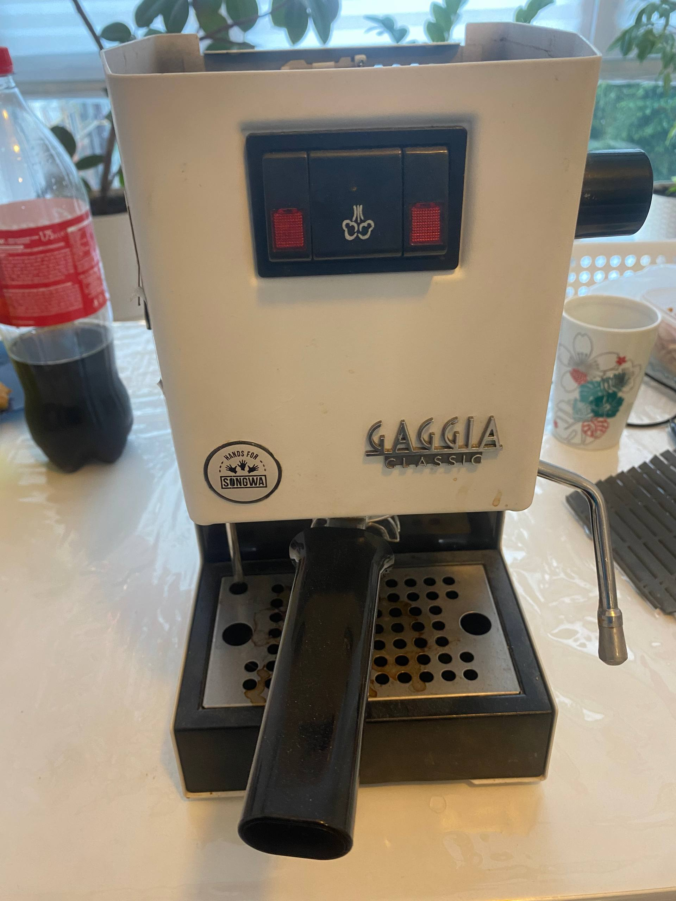

Усередині її вже раз модифікували: поверх стокової проводки стояв готовий PID-терморегулятор.
Усе це було демонтовано.

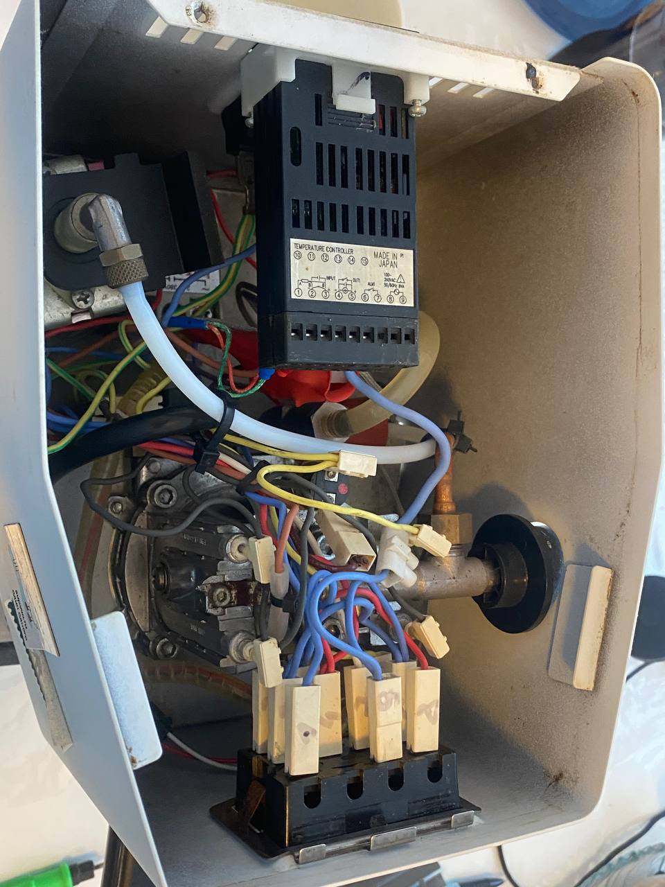

| Стоковий бойлер | Механічний паровий кран | Вібраційна помпа |
|---|---|---|
| 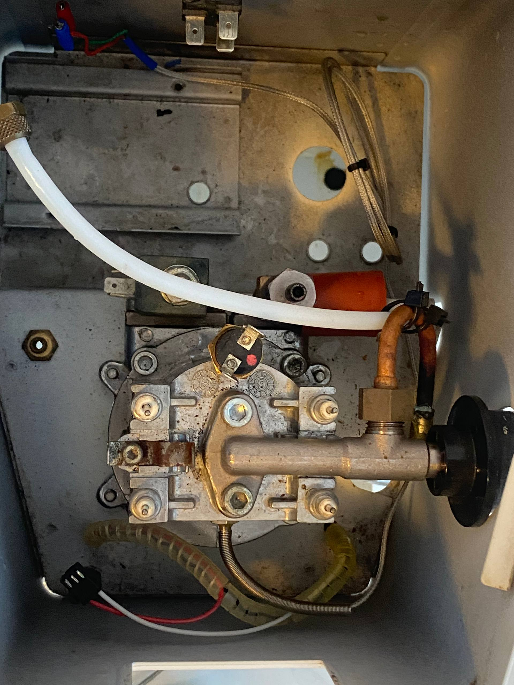 | 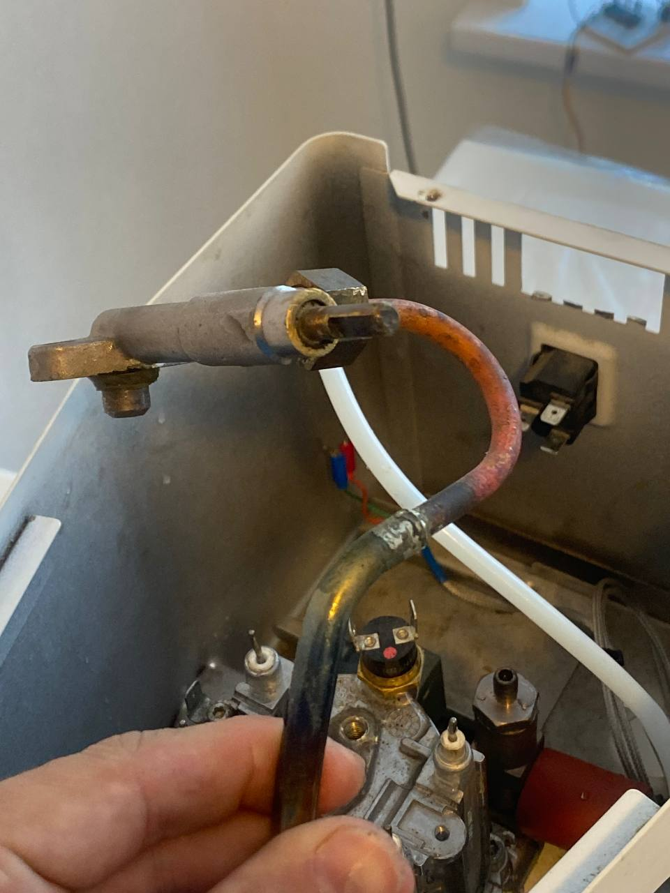 | 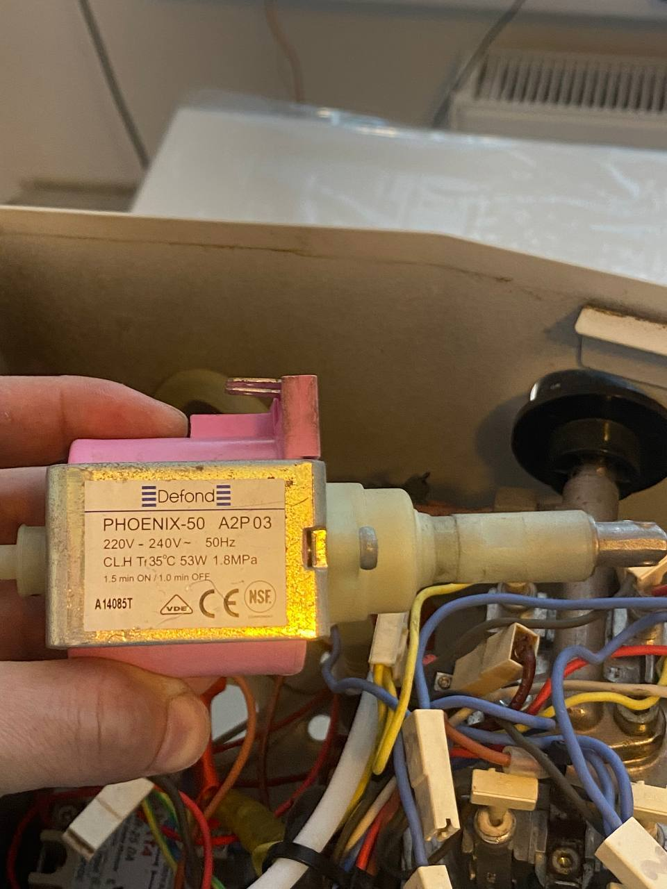 |

- **Бойлер** — один алюмінієвий бойлер з біметалевими термостатами, спочатку спільний для кави та пари.
  Він залишається на групі й тепер працює лише як кавовий бойлер.
- **Паровий кран** — ручний голчастий клапан на мідній трубці; замінений на електрокерований клапан.
- **Помпа** — вібраційна Defond Phoenix-50 (230 В, 53 Вт, 1.8 МПа, режим 1.5 хв роботи / 1 хв паузи).
  Керувати тиском чи потоком неможливо — замінена на BLDC-помпу.

---

## 2. Нова гідравліка

Усі нові гідравлічні компоненти перед встановленням: два циліндричні бойлери (преднагрів і пара), соленоїдні клапани Danfoss EV210A,
запобіжні/зворотні клапани та PTFE-трубки.

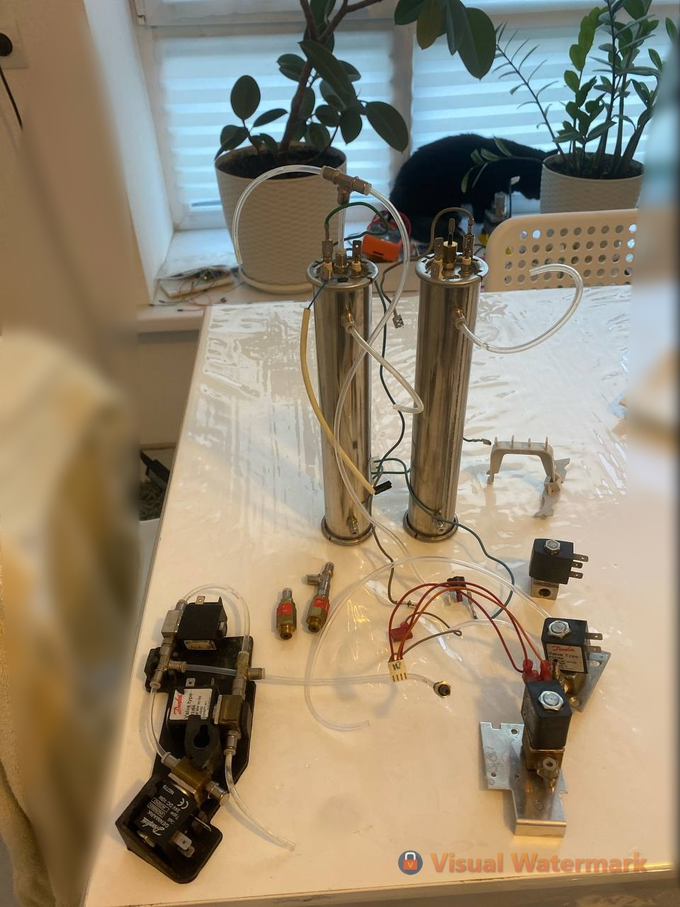

### BLDC-помпа + витратомір

Вібраційну помпу замінено на шестеренну BLDC-помпу. Витратомір стоїть безпосередньо на виході помпи, а вся
збірка тримається на надрукованих на 3D-принтері кронштейнах (синій хомут, жовта основа).

| | |
|---|---|
| 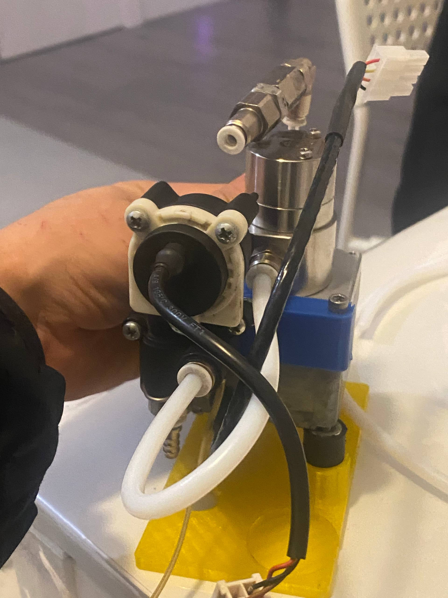 | 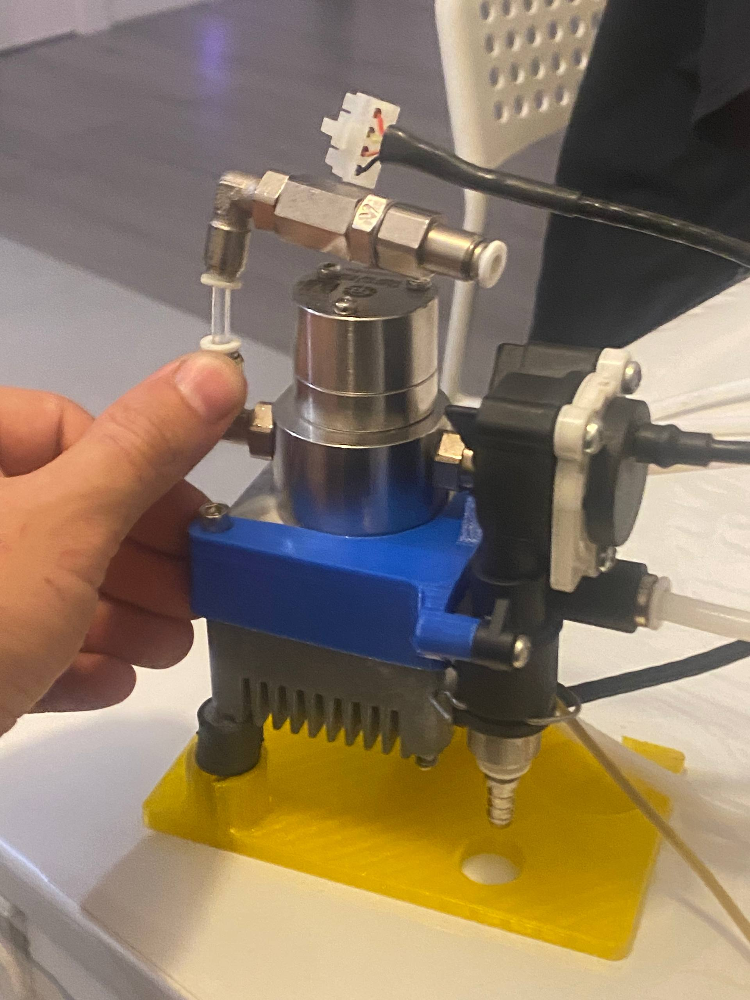 |

Швидкість помпи задається ШІМ із STM32 (TIM4, `PB6`), зворотний зв'язок по обертах — через тахо-вхід, див.
[`bldc_pump.c`](../Core/Src/bldc_pump.c).

### Паровий клапан з ШІМ

Ручний паровий кран замінено на соленоїдний клапан ODE 21AP1KC4V30 (G 1/8, DN 3.0 мм, 0–3.5 бар, котушка DC).
Керування котушкою через ШІМ дає регульований потік пари замість простого увімк./вимк.

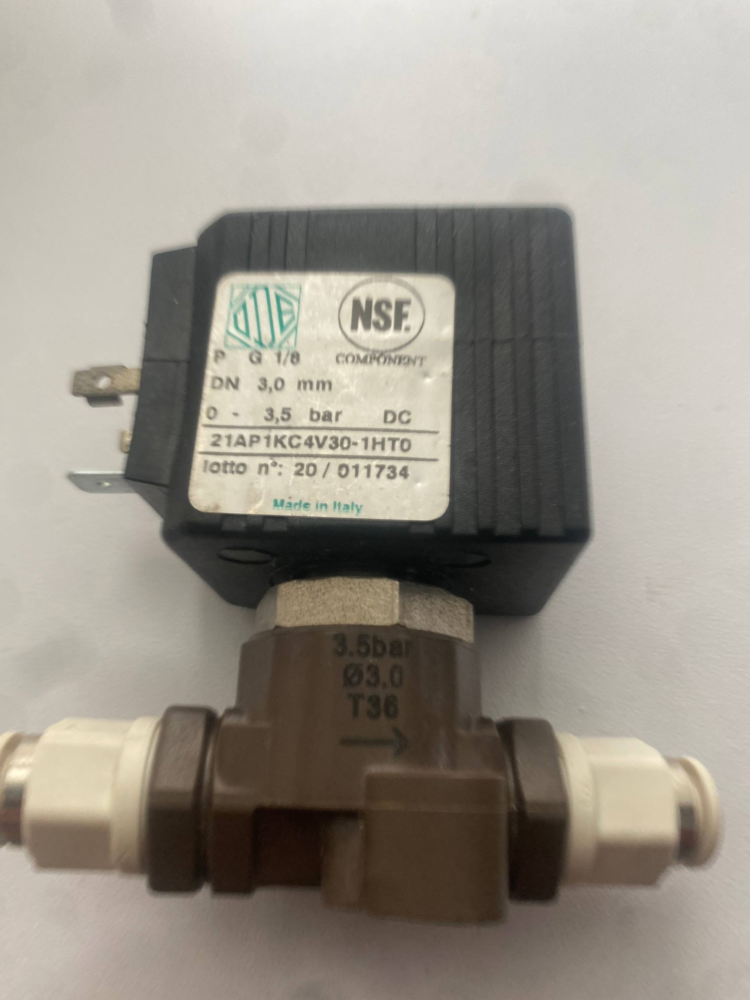

Налаштування ШІМ клапана: [відео](image/10_settings_pwm_valve.MP4)

---

## 3. Додатковий модуль корпусу

У корпусі Gaggia немає місця для другого бойлера, клапанів та електроніки, тому збоку додано модуль.

Модуль вирізано з нержавіючого корпусу донорської кавомашини (лінія різу позначена червоним):

| Донор | Вирізаний модуль |
|---|---|
| 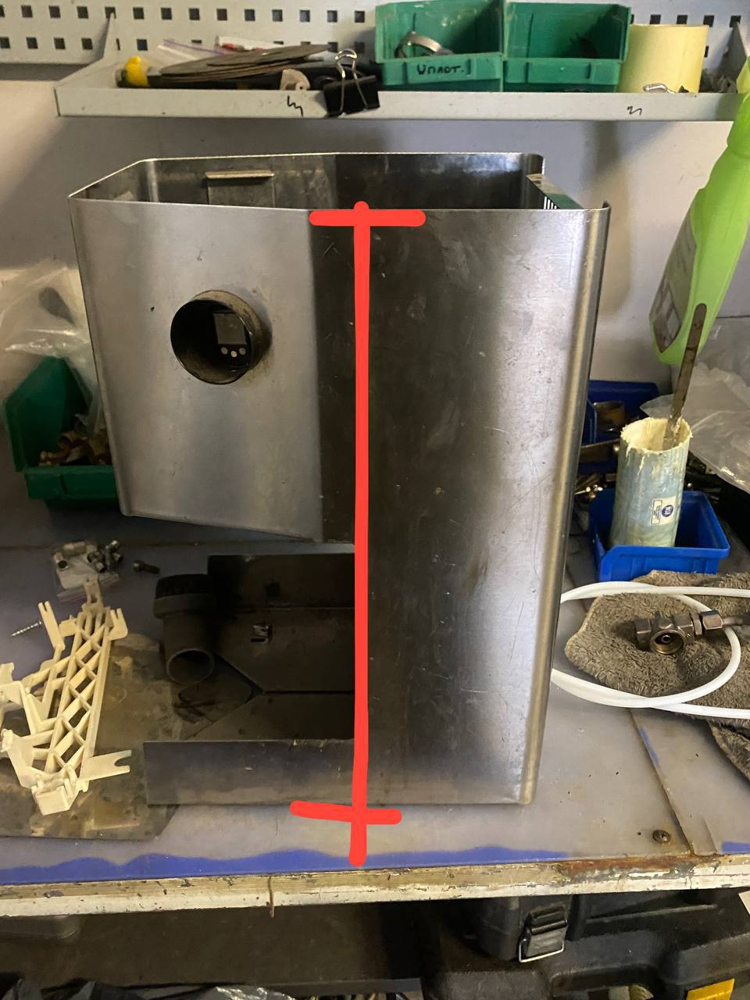 |  |

Щоб тонкий лист став жорстким і витримував бойлери, всередину вварено ребра жорсткості та кронштейни (TIG):

| | |
|---|---|
|  |  |

Примірка модуля до рами Gaggia:

| | |
|---|---|
|  |  |
|  |  |

---

## 4. Фарбування

Авторське аерографічне фарбування в стилі Lancia Rally 037 (W. Röhrl / K. Geistdörfer, №1):
білий корпус Gaggia, чорний модуль, смуги в стилі Martini.

---

## 5. Розподільні клапани

Соленоїдні клапани Danfoss EV210A (NC) з латунними трійниками утворюють блок розподілу води:
група, наповнення парового бойлера та гаряча вода.

| | |
|---|---|
|  |  |

Блок клапанів закривається кришкою, трубка виходить через проріз.

У прошивці кожен клапан — це вихід GPIO (`PA3` наповнення, `PA4` група, `PA5` гаряча вода). Під час старту
та в `Error_Handler()` усі клапани закриваються — див. [`valves.c`](../Core/Src/valves.c).

---

## 6. Встановлення бойлерів

Тепер у машині три бойлери:

- **Бойлер преднагріву** (циліндричний, у модулі) — підігріває воду перед подачею на групу.
- **Паровий бойлер** (циліндричний, у модулі) — лише для пари, з власним клапаном наповнення та щупом рівня.
- **Кавовий бойлер** — рідний бойлер Gaggia на групі.

Циліндричні бойлери встановлені вертикально в модулі на вварених кронштейнах, гідравліка — PTFE-трубки в спіральному обплетенні.

| | |
|---|---|
| 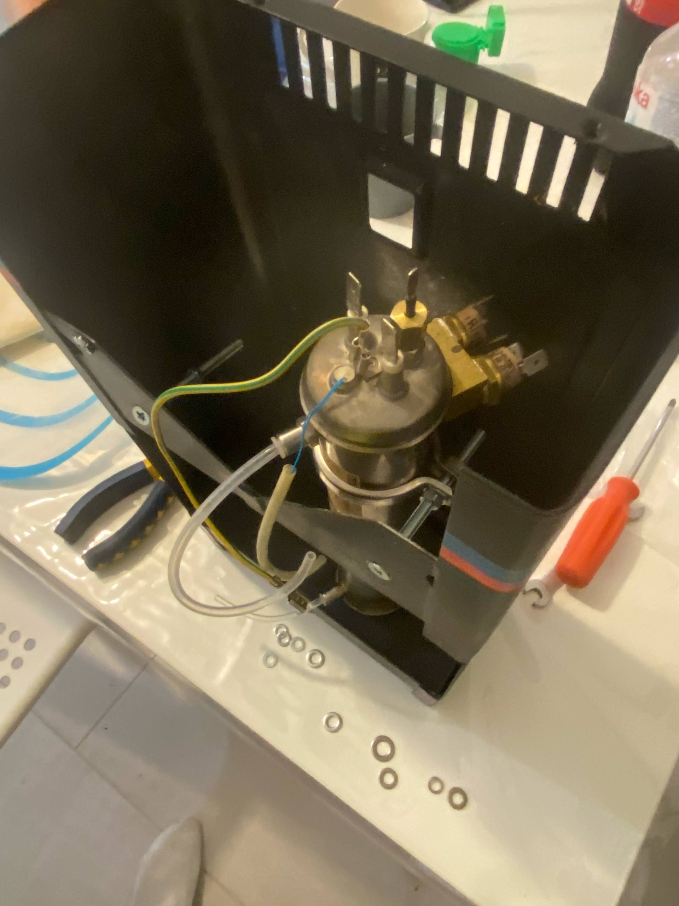 | 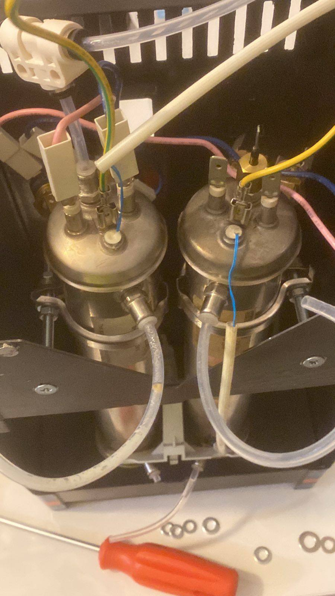 |
| 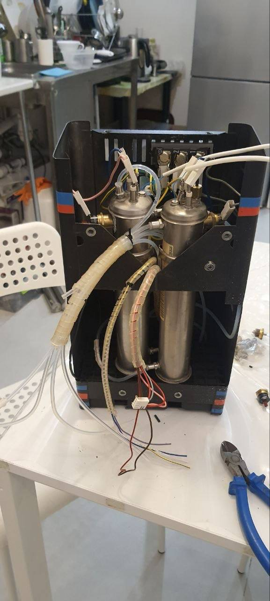 | 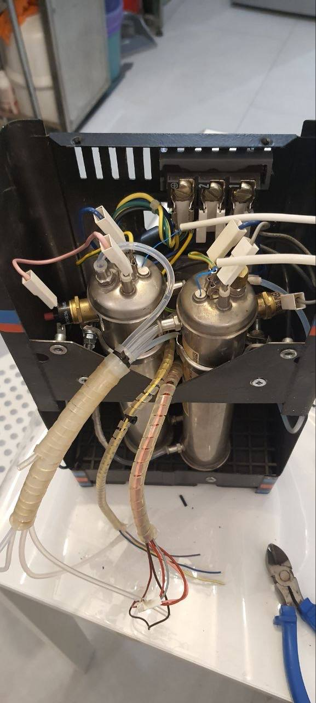 |

Кожен нагрівач вмикається через SSR (`PA0` преднагрів, `PA1` пара, `PA2` кавовий бойлер). Температура зчитується трьома
NTC-термісторами через ADC1 + DMA (Steinhart–Hart, підтяжка 1.5 кОм) — див. [`ntc_sensor.c`](../Core/Src/ntc_sensor.c).

Рівень води в паровому бойлері вимірюється кондуктометричним щупом: щуп збуджується ШІМ-сигналом з TIM1
(`PA8`), а амплітуда відгуку зчитується АЦП (`PA6`). Низька амплітуда — щуп у воді (WET), висока — DRY,
див. [`water_level_steam.c`](../Core/Src/water_level_steam.c).

### SSR

SSR встановлені на пластині-радіаторі всередині модуля, поруч із мережевим входом.

| | |
|---|---|
| 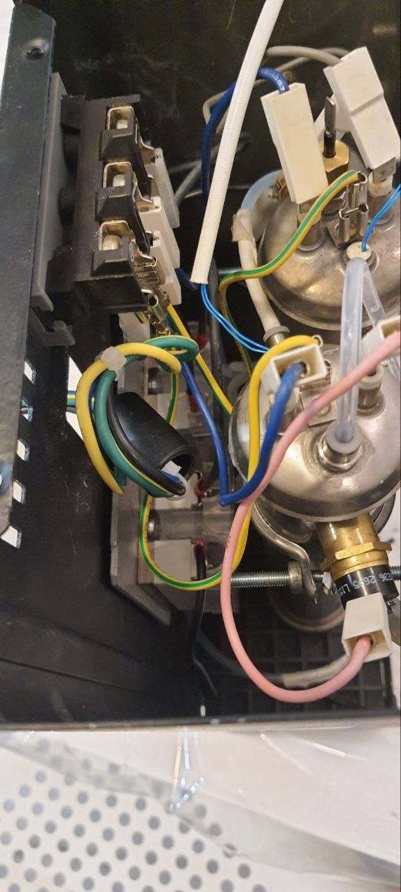 | 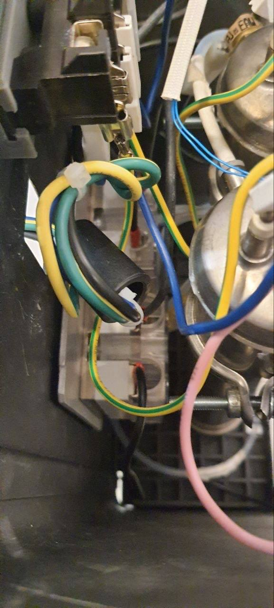 |

### Зібраний модуль

| Ззаду (мережевий роз'єм IEC) | Збоку |
|---|---|
|  |  |

---

## 7. Інтерфейс користувача

Оригінальну панель перемикачів прибрано. Замість неї — дисплей у надрукованій рамці «Bare Metal» і тактильна
ручка збоку, там, де раніше був паровий кран.

| Кабельний ввід для ручки | Корпус дисплея |
|---|---|
|  | 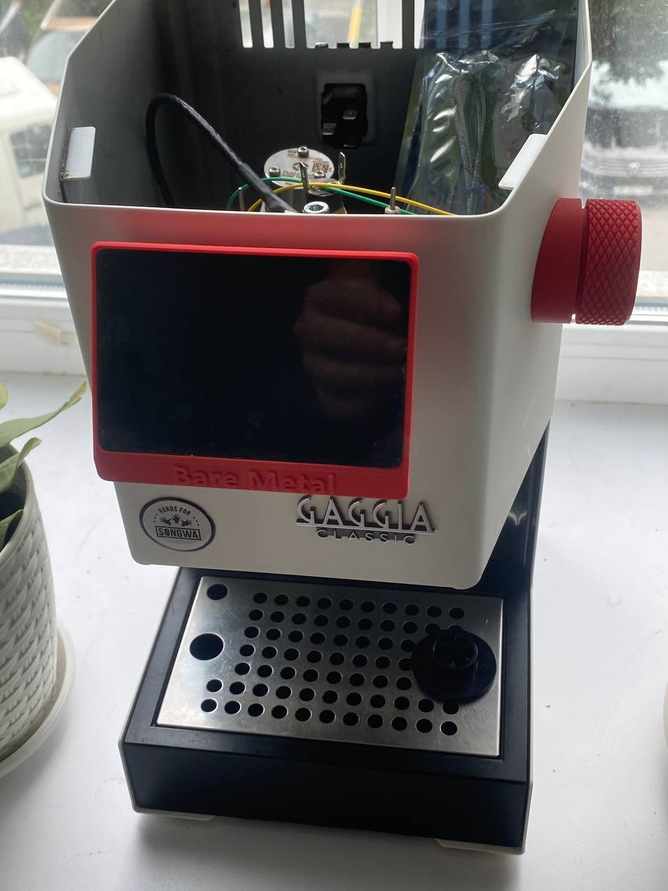 |

### Тактильна ручка

Ручка — це маленький гімбальний BLDC-мотор із магнітним енкодером кута в надрукованому корпусі з накаткою.
Мотор програмно створює «клацання» та упори, тож одну ручку можна використовувати для будь-якого меню.

| | |
|---|---|
|  |  |

| Корпус з магнітом | Плата енкодера |
|---|---|
|  | 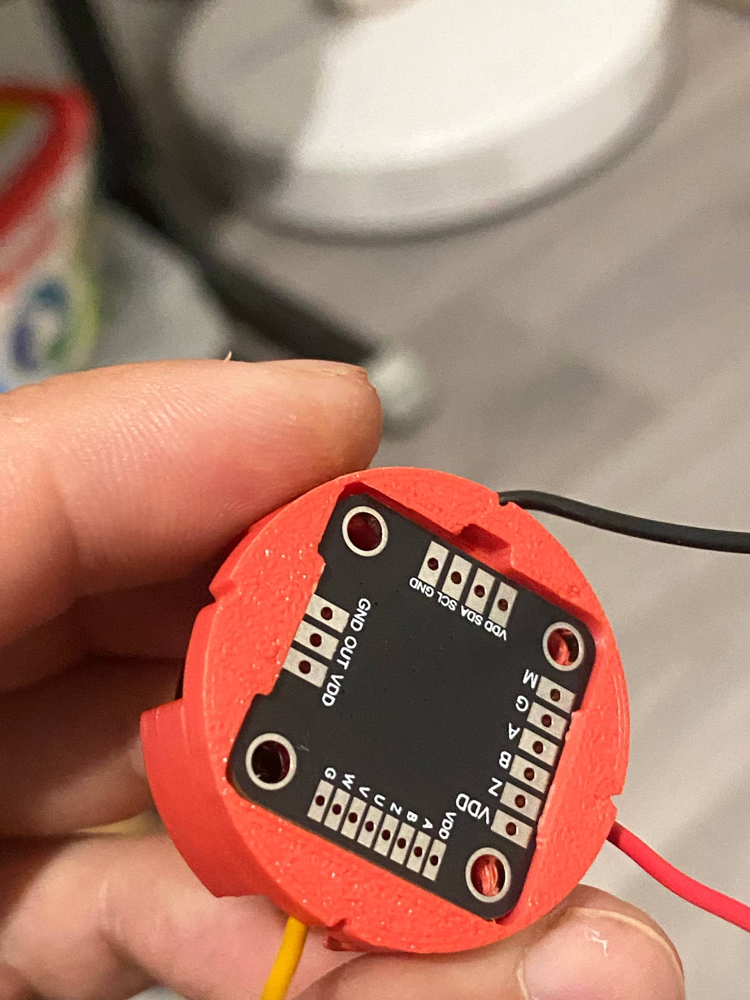 |

| Гімбальний BLDC | Тест на столі |
|---|---|
| 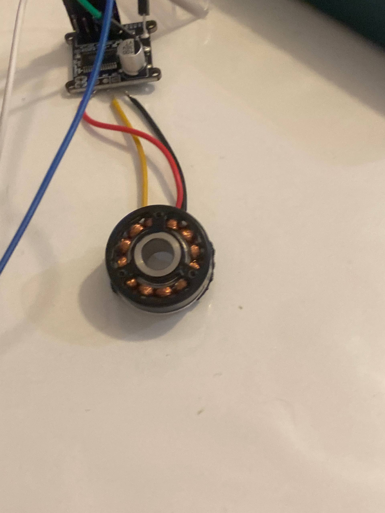 | 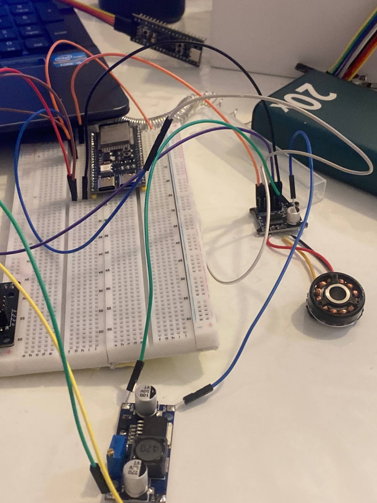 |

Тест на столі: плата ESP32, драйвер BLDC, понижувальний перетворювач і мотор на макетній платі.

Дисплей і тактильна ручка працюють на окремому ESP32. STM32 відповідає за все, що пов'язано з водою та мережею
(нагрівачі, клапани, помпа, датчики); ESP32 займається лише інтерфейсом користувача.

---

## Стан прошивки

MCU: STM32F401 (CubeMX + CMake, `arm-none-eabi-gcc`).

Прошивка STM32 написана вручну. Прошивка інтерфейсу на ESP32 (дисплей + тактильна ручка) розробляється
за допомогою ШІ-асистента.

| Модуль | Файл | Стан |
|---|---|---|
| ADC1 + DMA (NTC ×3, щуп рівня) | `adc_dma.c` | готово |
| Температура NTC (Steinhart–Hart) | `ntc_sensor.c` | готово, потрібна перевірка обриву/КЗ за температурою |
| Щуп рівня води парового бойлера | `water_level_steam.c` | готово, поріг ще налаштовується |
| Соленоїдні клапани | `valves.c` | готово |
| UART-лог | `log.c` | готово |
| BLDC-помпа (ШІМ + тахо) | `bldc_pump.c` | в роботі |
| Керування нагрівом (PID + SSR) | — | todo |
| Дисплей / тактильна ручка (ESP32) | окремий проєкт | todo |
